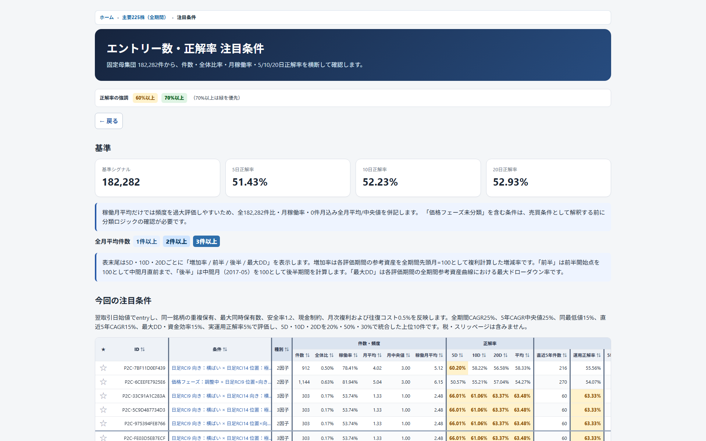
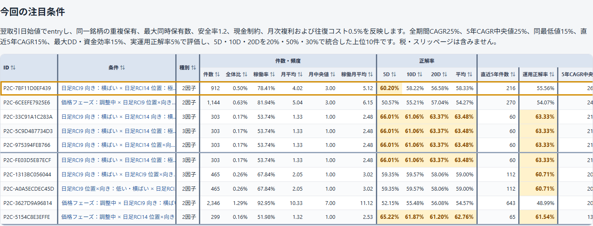
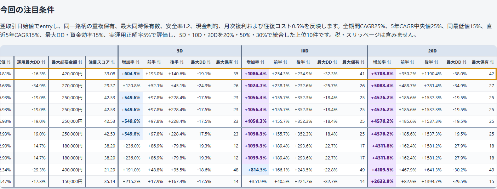
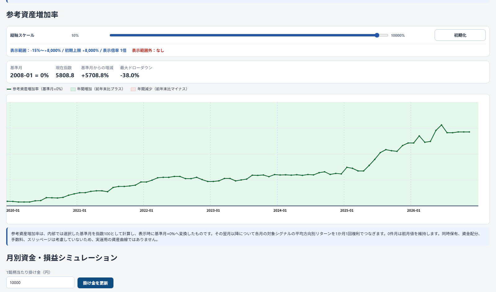

# P2 株式分析レポート

主要225株の過去データを、価格推移・EMA・RCIなどの条件別に集計した閲覧用レポートです。
条件ごとのエントリー件数、正解率、参考資産増加率、最大ドローダウン、月次推移などを確認できます。

[公開サイトを見る](https://yuki746289.github.io/product_kabu_web/)

## 主な分析内容

- 条件別のエントリー件数・出現頻度
- 5日・10日・20日後の正解率
- 参考資産増加率と最大ドローダウン
- 月別・年別・Rolling・相場状態別の集計
- 単独条件、複数条件および業種別の比較

## 画面イメージ

### 注目条件

エントリー件数、正解率、直近の再現性などを横断して条件を比較できます。

### 条件別結果一覧

条件名、件数、稼働率、正解率、参考資産増加率、最大ドローダウンなどを一覧で確認できます。

#### 基本情報・正解率

増加率5,000%付近の条件まで縦スクロールし、対象条件と周辺条件の基本情報・正解率を表示しています。

#### 増加率・最大ドローダウン

1枚目と同じ縦位置で表を右側へスクロールし、増加率 **+5,708.8%** の条件と周辺条件について、5D・10D・20Dの増加率、前半・後半、最大DD、最大保有数を表示しています。

## 分析結果の一例

過去データ内では、次の条件で高い参考資産増加率が確認されました。

| 項目 | 結果 |
|---|---:|
| 条件ID | `P2C-7BF11D0EF439` |
| 条件 | 日足RCI9 向き：横ばい × 日足RCI14 位置：極端に低い |
| 種別 | 2因子 |
| エントリー件数 | 912件 |
| 評価期間 | 20D |
| 20D正解率 | 56.58% |
| 20D参考資産増加率 | **+5,708.8%** |
| 最大ドローダウン | -38.0% |

### 参考資産増加率の推移

表の条件を20Dで表示し、グラフを直近期間まで移動した画面です。数値と推移を同時に確認できます。

[この条件のグラフを開く](https://yuki746289.github.io/product_kabu_web/graph.html?dataset=02_nikkei_225_all&subject_type=condition&subject=h-7bf11d0ef4392660)

> 参考資産増加率は、過去データを使った分析上の参考値です。将来の利益や運用成果を保証するものではありません。グラフを開いた後、評価期間を「20D」に切り替えると上記条件の20日評価を確認できます。

## データについて

- 公開内容は月次の参照用スナップショットです。
- リアルタイムの売買指示を提供するものではありません。
- 計算ロジックや内部処理コードは公開していません。
- 各指標の集計条件・前提は、サイト内の注記を参照してください。

## 免責事項

本サイトは、過去データに基づく分析結果を閲覧するためのものです。投資助言や特定銘柄の売買推奨を目的としたものではありません。実際の投資判断は、ご自身の責任で行ってください。